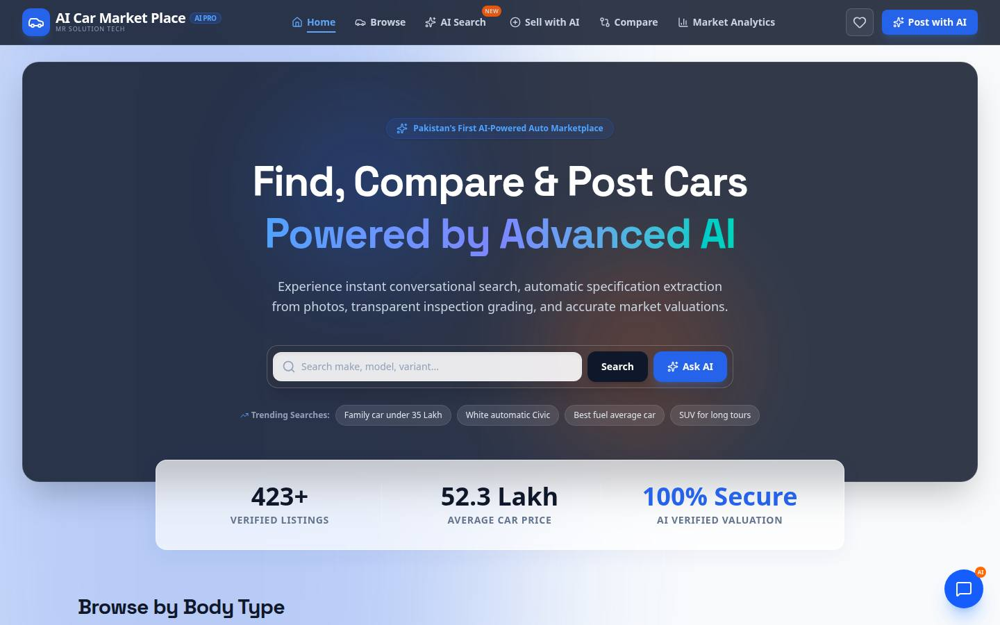
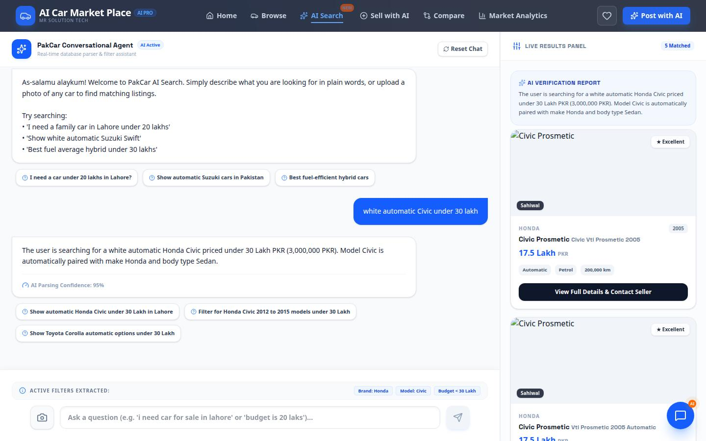
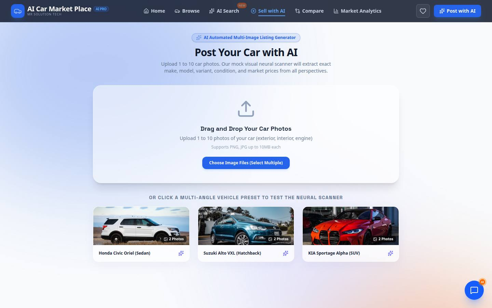
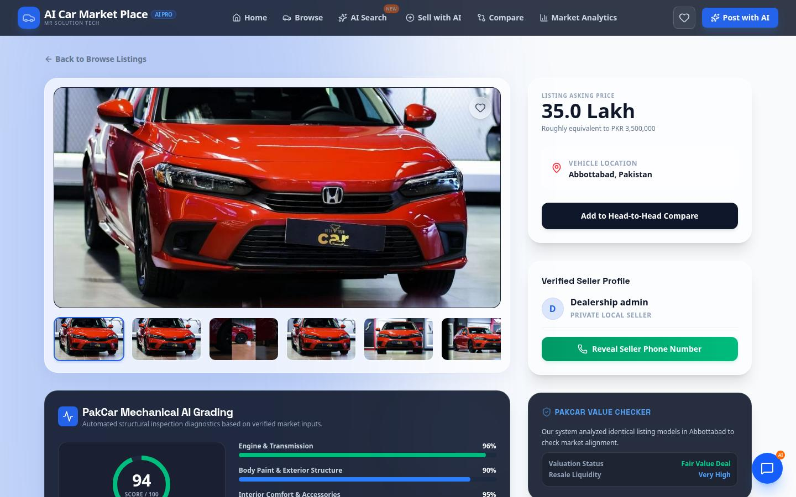
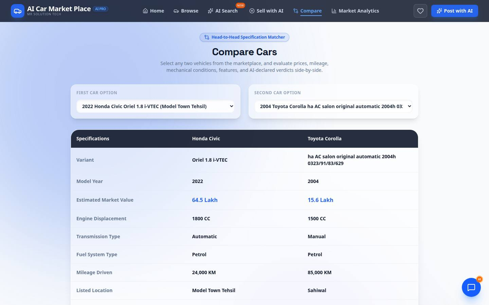
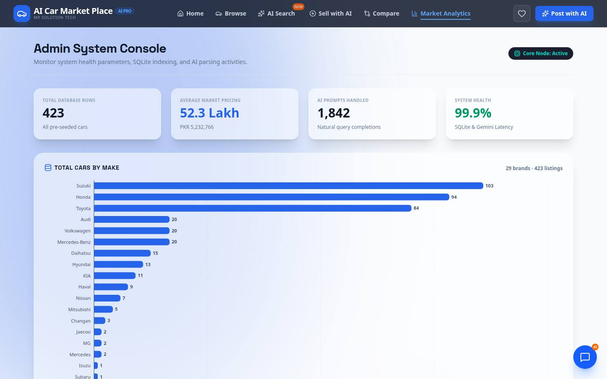
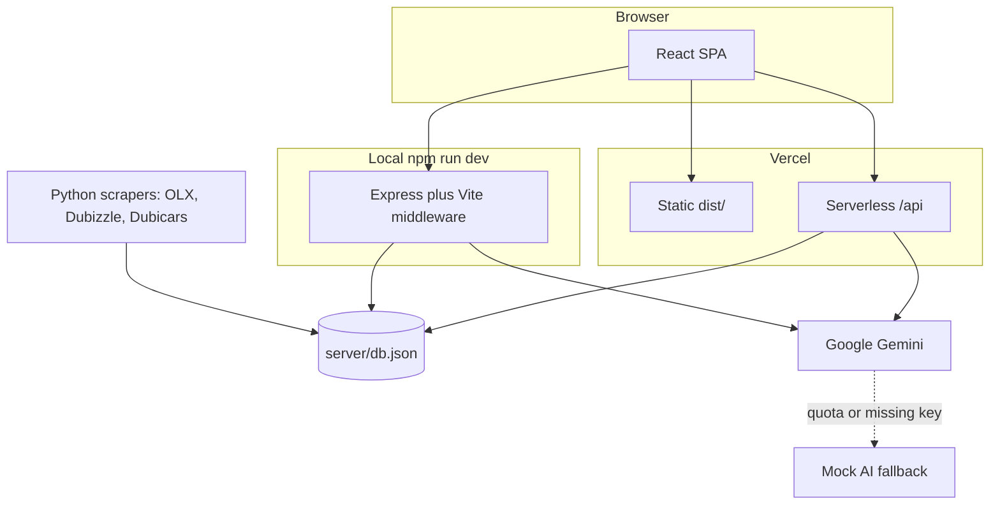

# AI Car Marketplace

Pakistani used-car marketplace with conversational search, photo-to-listing drafts, side-by-side comparison, and market analytics. Buyers describe a car in plain language. Sellers upload photos and get a filled listing. The live catalog is about 420 listings normalized from public car ads.

**Live demo:** [https://ai-car-marketplace-eta.vercel.app](https://ai-car-marketplace-eta.vercel.app)

**Built by:** [Your Name](https://www.upwork.com/) — replace this with your name and Upwork profile before you publish the repo.

## Screenshots

<table>
  <tr>
    <td></td>
    <td></td>
  </tr>
  <tr>
    <td></td>
    <td></td>
  </tr>
  <tr>
    <td></td>
    <td></td>
  </tr>
</table>

Browse with photos: [docs/screenshots/02-browse.jpg](docs/screenshots/02-browse.jpg). Seller hub (not linked in the header): [docs/screenshots/08-seller-hub.jpg](docs/screenshots/08-seller-hub.jpg).

## Features

- Home search that routes keywords to browse, or the same text to AI search
- Filterable browse (make, body, city, transmission, fuel, price, year, mileage) with favorites kept for the browser session
- Listing pages with gallery, seller phone reveal, similar cars, and a condition-based inspection score
- Compare any two listings
- Seller hub with demo leads and pricing notes (`/seller`, hidden from the nav)
- Admin analytics for brand, body, city, year, and price mix (`/admin`)

## AI features

Google Gemini runs on the server. If `GEMINI_API_KEY` is missing, or a model call fails, the same routes fall back to a local parser so the demo still answers.

| Capability | What it does |
| --- | --- |
| Natural-language search | Turns a prompt such as "white automatic Civic under 30 lakh" into filters, then returns matching rows from the catalog |
| Photo search | A buyer photo is identified first, then used as the search prompt |
| Concierge chat | Floating assistant for recommendations, comparisons, fuel economy, and typical Pakistan finance or insurance ranges. It can cite live listings |
| Sell with AI | One to ten photos become make, model, variant, condition, features, SEO copy, and a PKR price range |
| Seller copy | Rewrites a title and description and suggests a price for a listing the seller already has |
| Recommendations | Similar and lower-priced cars on the listing page, ranked in the API |

The detail-page inspection bars and the `/api/ai/pricing` estimate are deterministic formulas from the listing fields. They do not call Gemini. Photo analysis and conversational search do.

## Tech stack

- React 19, TypeScript, React Router 7, Tailwind CSS 4, Motion, Recharts, Lucide
- Vite 6
- Express 4 API, shared by the local server and a Vercel serverless function
- Google Gemini via `@google/genai`, with a model fallback chain
- JSON catalog (`server/db.json`) built from scraper output
- Python scrapers (Playwright) for OLX Pakistan, Dubizzle, and Dubicars

## Architecture



Locally, `server.ts` mounts the API and the Vite dev server on one port. On Vercel, `vercel.json` serves the Vite build and sends `/api/*` to `api/index.ts`. The browser also falls back to `/cars-data.json` if the API is unreachable. That file is generated at build time from `server/db.json` and is not committed.

## Local setup

Node.js 20 or newer.

```bash
npm install
cp .env.example .env.local
# Put your Gemini key in .env.local
npm run dev
```

Open [http://localhost:3000](http://localhost:3000).

Useful scripts:

| Script | Purpose |
| --- | --- |
| `npm run dev` | API and Vite together |
| `npm run lint` | Typecheck with `tsc --noEmit` |
| `npm run build` | Client build plus a bundled Node server in `dist/server.cjs` |
| `npm run vercel-build` | Static client build and `public/cars-data.json` |
| `npm run rebuild:db` | Rebuild `server/db.json` from `data/*.json` |
| `npm run import:olx` | Scrape more OLX ads, then rebuild the catalog |

Scraper setup and flags are documented in [car scraper/README.md](car%20scraper/README.md).

## Environment variables

Copy `.env.example` to `.env.local`. Do not commit `.env` or `.env.local`.

| Variable | Required | Used for |
| --- | --- | --- |
| `GEMINI_API_KEY` | For live AI | Search, chat, photo listings, seller copy |
| `APP_URL` | No | Public URL of this app |
| `PORT` | No | Local server port, default `3000` |
| `NODE_ENV` | No | `development` or `production` |
| `DISABLE_HMR` | No | Turns off Vite HMR |
| `OLX_URL`, `OLX_MORE`, `OLX_ADS_LIMIT` | No | OLX scraper target and limits |
| `HEADLESS`, `MAX_IMAGES`, `REQUEST_DELAY` | No | Scraper browser and pacing |

On Vercel, set `GEMINI_API_KEY` in the project environment. The serverless function reads `process.env` directly.

## Deployment

The production site is a Vercel project connected to this repo.

1. Import the GitHub repo in Vercel. `vercel.json` sets the build command and output directory.
2. Add `GEMINI_API_KEY`.
3. Deploy.

After deploy, `https://YOUR_APP.vercel.app/api/cars` should return the catalog JSON, and AI search should answer a prompt such as "Civic under 30 lakh".

`npm run build && npm start` runs the same API and the static client without Vercel.

## Notes before you publish

- Many OLX thumbnail URLs return HTTP 403. Listing photos fall back to `public/car-placeholder.svg`. Dubizzle and Dubicars images load directly.
- `POST`, `PUT`, and `DELETE` on `/api/cars` are unauthenticated. Treat the catalog as demo data.
- Seller hub and market analytics are open demo screens. There is no account system on this branch.
- Phone numbers on listings are generated from ad ids. They are not scraped private contacts.

## License

[MIT](LICENSE). Copyright 2026 [Your Name]. Replace the copyright holder in `LICENSE` before you make the repository public.
